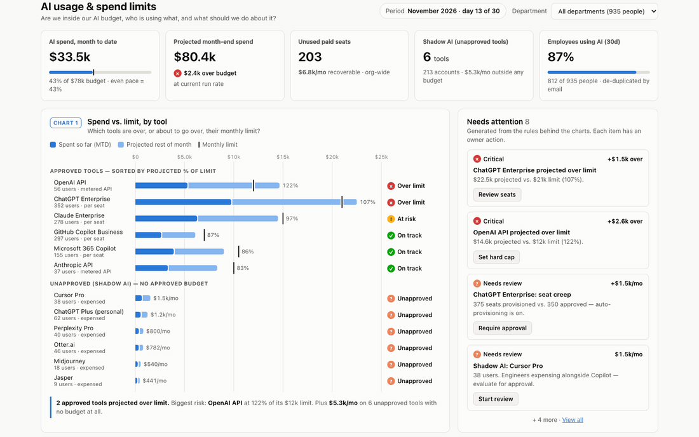

# AI Governance Dashboard: APM take-home prototype

Plain HTML + CSS + JavaScript, no build step and no dependencies.

**Run:** open `index.html` in a browser (or `python3 -m http.server` and visit `localhost:8000`).

| Tab | Assignment part |
|---|---|
| 1 · Dashboard | Part 1: one interactive screen (department filter, hover tooltips, light/dark) |
| 2 · Data sources | Part 2: API & data source plan, including which AI vendors expose usage/cost APIs |
| 3 · Why these 3 charts | Part 3: the three charts, the question each answers, and what was left out |

Files: `js/data.js` (illustrative data model), `js/app.js` (calculations + hand-drawn SVG charts), `css/styles.css`.
All data is fictional.

## Screenshots & GIFs (`docs/media/`)

| File | Shows |
|---|---|
| `01-dashboard-full.png` / `02-dashboard-above-fold.png` | Full dashboard / first screen |
| `03`–`08` | KPI tiles, Chart 1, Chart 2, Chart 3, Needs attention, tool inventory |
| `09-dashboard-engineering-filter.png` | Dashboard filtered to Engineering |
| `10-data-sources.png` / `11-three-charts-rationale.png` | Parts 2 and 3 |
| `12-dashboard-dark.png` / `13-dashboard-mobile.png` | Dark mode, phone width |
| `gif-01`…`gif-05` | Department filter, Chart 2 hover, Chart 1 hover, heatmap hover, tab tour |
